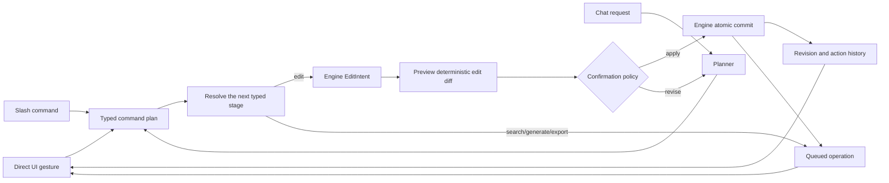

# Videobook MVP Product Requirements

## The searchable audio notebook for video

| Field | Value |
| --- | --- |
| Status | Proposed MVP baseline |
| Product | Videobook |
| Date | 2026-07-24 |
| Tracking | `vb-c8a` |
| Engine dependency | `~/videobook-engine/docs/mvp-prd.md` (`ve-4i9`) |
| Target release | Creator beta |

## 1. Executive decision

Videobook will be an audio-first, local-first video notebook in which a creator
can find any useful moment in their media and turn an idea into a reversible
edit through any of three equivalent control surfaces:

1. direct manipulation in the notebook, search results, viewer, and timeline;
2. deterministic slash commands;
3. conversational instructions.

All three surfaces must resolve to the same typed command plan. Every semantic
edit stage must preview through the same engine diff, commit through the same
engine transaction, and produce the same revision history. Chat is therefore
not a second editor and slash commands are not shortcuts around the data model.

The MVP will not attempt feature-for-feature parity with CapCut. It will beat
CapCut for a focused beachhead: creators with narration, interviews, podcasts,
research, and a growing personal footage library who spend more time finding,
organizing, and rough-cutting material than applying effects.

## 2. Product promise

> Speak or write the story, find any matching moment, and get a trustworthy
> first cut without surrendering editorial control.

The shortest successful experience is:

1. record or import an audio/video source;
2. receive a time-aligned transcript and progressively searchable media;
3. describe a desired shot, quote, sound, or visual reference;
4. audition timecoded results and attach them to the narration;
5. ask Videobook to assemble or revise a cut;
6. inspect the proposed changes, commit them, refine directly, and export.

## 3. What “audio notebook” means

An audio notebook is not a playlist and it is not a chat log. It is a durable
creative document with an audible spine and linked evidence.

- The primary spine can be recorded narration, an interview, a podcast, a
  script rendered as speech, or the audio from a source video.
- Speech is represented as editable, word-timed transcript blocks. Non-speech
  regions can be labeled as music, ambience, silence, applause, laughter, or a
  user note.
- Search queries, result selections, prompts, generated assets, and sequence
  outputs are first-class notebook cells with provenance.
- Deleting or moving transcript text creates non-destructive edit decisions;
  it never mutates source media.
- A creator can move between the notebook and precision timeline without
  losing intent, selections, or history.

## 4. Problem

AI video tools have made generation abundant while leaving source selection and
editorial control fragmented.

- A creator cannot reliably search a large personal library for a precise
  visual moment, quoted phrase, on-screen word, or sound.
- Reverse image lookup commonly stops at whole images; it does not return the
  best matching ranges inside videos. Reverse video lookup is rarer still.
- Text-based editors make spoken-word cuts fast but do not make the surrounding
  footage library behave like an evidence base.
- Prompt-based editors often execute opaque changes immediately, forcing the
  user to inspect the result rather than the plan.
- Traditional timelines are precise but require the user to remember where
  everything is and manually repeat high-level intent.
- Separate UI, command, and chat implementations drift in behavior and
  reliability.

## 5. Market bar and wedge

This comparison is a product benchmark, not a claim that the cited products
have identical behavior on every plan or platform.

| Market bar | Evidence as of 2026-07-24 | Videobook MVP win condition |
| --- | --- | --- |
| AI-assisted creator editor | CapCut advertises Script to Video, Smart Search over objects, speech, people, and environments, filler-word removal, auto reframe, captions, scene detection, keyframes, and background removal in [CapCut Desktop](https://www.capcut.com/tools/desktop-ai-power). | Deliver a faster source-to-first-cut workflow for narration-led projects, with transparent sources and reversible plans. |
| Text-based editing | CapCut supports transcript-synchronized edits and filler/silence removal in its [transcript editor](https://www.capcut.com/tools/video-transcript-editing). Descript makes transcript edits directly update underlying media in [Edit like a doc](https://help.descript.com/hc/en-us/articles/15726742913933-Edit-like-a-doc). | Make the transcript the notebook spine, then connect every selected line to searchable or generated visual evidence. |
| Semantic media retrieval | Adobe Premiere combines visual analysis, transcript text, and embedded metadata in one [Media Intelligence search](https://www.adobe.com/learn/premiere-pro/web/media-intelligence-search-ai). | Return moment-level hybrid results and add reverse image, selected-frame, video-range, and audio-range queries in the same result surface. |
| Credible timeline | CapCut advertises automatic cutting and a layered [multi-track editor](https://www.capcut.com/tools/auto-video-editor). | Ship the essential multi-track operations required to finish the focused workflow, while explicitly deferring a broad effects/template catalog. |
| AI trust | Current editors expose many isolated AI tools. | Compile UI, slash, and chat intent into one inspectable plan with costs, warnings, diffs, provenance, revision history, and one-step restore. |

“Beat CapCut” for MVP means winning a measured workflow, not claiming universal
NLE superiority. A qualified beta creator must be able to go from one hour of
raw narration plus a pre-indexed library to a credible 60-second cut faster in
Videobook than in CapCut, and must find annotated visual moments with higher
top-five recall where the current CapCut build can index the same corpus.
Effects breadth, mobile reach, and template inventory are post-MVP competition.

The category Videobook intends to lead is **AI-native source-to-cut editing**:
the path from a large, mixed media library and an audible idea to a controlled
first cut. Leadership expands in three steps:

1. win retrieval, audio-notebook assembly, and trustworthy edits in MVP;
2. deepen finishing, reusable workflows, and team review after retention is
   proven;
3. expand distribution through collaboration, templates, plugins, and
   additional clients without weakening local ownership.

## 6. Target users

### 6.1 Primary: narration-led solo creator

The primary user makes explainers, essays, product stories, educational clips,
video podcasts, or social cuts. They have 20–500 hours of accumulated footage,
use AI generation selectively, publish in multiple aspect ratios, and need a
finished result without becoming a professional NLE operator.

Primary jobs:

- “When I know the shot or quote I want but not where it lives, find the exact
  moment quickly.”
- “When I have narration or an interview, turn its strongest ideas into a
  sourced rough cut.”
- “When I describe an edit, show me what will change before changing it.”
- “When the AI is wrong, let me correct the result directly without starting
  over.”
- “When I return weeks later, preserve the reasoning, sources, and versions.”

### 6.2 Secondary: research and documentary editor

This user searches interviews, screen recordings, archival media, and field
footage. They value quoted speech, named sources, timecodes, lineage, and the
ability to save searches and selects before building a sequence.

### 6.3 Secondary: AI-native content studio

This user mixes recorded media with generated images, video, speech, and sound.
They need provider choice, cost visibility, reusable notebook flows, and exact
provenance for every generated or transformed asset.

### 6.4 Not the MVP target

- feature-film finishing, broadcast conform, or collaborative post-production;
- template-first casual mobile creation;
- live multi-user editing;
- a stock marketplace or social network;
- a complete motion-graphics, color-grading, or audio-DAW replacement.

## 7. Experience principles

1. **The result is a moment, not a file.** Search lands on a useful time range
   with an immediately playable preview.
2. **Audio supplies structure; visuals supply evidence.** The notebook makes
   their relationship explicit.
3. **Show the edit before doing the edit.** Multi-step, destructive, paid, or
   ambiguous operations require a plan preview.
4. **One intent, one action model.** UI, slash, and chat cannot produce
   different semantics.
5. **Direct manipulation always remains available.** AI accelerates precision;
   it does not replace it.
6. **Local by default is a product feature.** Core editing and local search
   work without uploading private media after required models are installed.
7. **Every output answers “why this?”** Search hits and AI edits expose the
   signals, source ranges, inputs, provider, cost, and revision.
8. **Progress is useful before processing is complete.** Transcript and
   metadata search arrive before visual indexing finishes; indexing is
   resumable and visible.

## 8. Current product baseline

The repository snapshot audited on 2026-07-24 already provides a substantial
foundation:

- React 19/Vite client and an Express MCP server;
- 238 documented MCP endpoints and 118 documented static slash commands;
- book-scoped `videobook-engine` roots, CAS-managed media, Dolt revisions,
  runtime jobs, action history, and recovery;
- typed notebook graphs for prompts, characters, scenes, assets, images, and
  videos;
- upload processing, thumbnails, sampled frames, waveforms, transcription,
  scene detection, media transforms, generation providers, Remotion/ffmpeg
  renders, captions, and three output orientations;
- a sequential visual-slot timeline with timed audio overlays;
- a command composer with asset mentions and prompt history;
- natural-language routing to one selected tool;
- a global archive whose search is metadata/transcript substring matching.

The engine also has opt-in, local, book-scoped similarity for whole image,
video, audio, and text artifacts. The application does not configure or expose
that API today.

The MVP gaps are:

- no unified application search across transcript, OCR, visual, audio, and
  metadata signals;
- no moment-level visual/audio index or timecoded reverse-media result;
- no natural-language-to-visual retrieval in the current engine contract;
- no image-to-video or video-range-to-video-range retrieval;
- no audio/transcript/search/select sequence as first-class notebook cells;
- no normalized multi-track clip model with source in/out ranges;
- no shared preview/commit command contract;
- chat chooses and immediately executes one tool rather than producing a
  multi-action plan;
- no controlled product benchmark for search quality or time-to-first-cut.

## 9. Canonical MVP workflow

### 9.1 Start and ingest

The creator creates a book or opens an existing one, then drags files, pastes a
supported URL, or records microphone audio. Ingest creates source artifacts
immediately. Processing status shows independent steps for media inspection,
proxy/preview generation, waveform, transcript, OCR/visual/audio indexing, and
errors. The user can start organizing before all indexes are ready.

### 9.2 Build the audio spine

The creator opens the default Main notebook and chooses a source as its audio
spine. Videobook displays speaker-aware, word-timed transcript blocks beside
the waveform. The creator can correct words, remove or restore ranges, reorder
blocks, add notes, and mark chapters. These operations create sequence edits,
not source mutations.

### 9.3 Search and collect

The creator can:

- type “wide shot of a red van arriving at dusk”;
- search a quoted phrase or on-screen word;
- select a frame and choose Find similar;
- select a two-to-ten-second video range and choose Find similar;
- select an audio range and search for similar sound;
- drag an image or video into the search field as a reference.

Results are timecoded moment cards with a representative frame, hover/scrub
preview, duration, source, transcript/OCR excerpt when relevant, match reasons,
and index readiness. A result can be played in context, pinned to a selects
cell, or inserted over a notebook transcript range.

### 9.4 Plan with any surface

The creator can express “cover the first paragraph with the best workshop
b-roll, avoid repeated shots, and keep each cut between two and four seconds”
through chat, a slash command, or a direct selection action.

Every path produces an action-plan drawer containing:

- resolved source ranges and destination ranges;
- an ordered operation list;
- a before/after sequence diff;
- conflicts, missing indexes, and assumptions;
- estimated provider spend and render work;
- Apply, Edit plan, and Cancel controls.

### 9.5 Refine and export

After commit, the timeline and notebook update together. The creator can trim,
split, move, replace, mute, fade, crop/reframe, add a dissolve, change speed,
reverse, edit captions, and adjust a small set of transforms. They can restore
the prior revision in one action. Export creates a revision-pinned 1080p MP4
for 16:9, 9:16, or 1:1 with progress, cancellation, and a durable output
artifact.

## 10. Product architecture



Application responsibilities:

- interaction design and synchronized notebook/search/viewer/timeline state;
- parsing deterministic slash grammar;
- conversational planning and clarification through `@apicity` providers;
- federating book-scoped engine search into optional library-wide results;
- model/provider settings, cost estimates, policy, and credentials;
- MCP tools, job workers, media serving, and export orchestration;
- telemetry that contains product events but no private media or prompt bodies
  by default.

Engine responsibilities are specified in the sibling engine PRD. In summary,
the engine owns media identity, timebases, temporal indexes, search primitives,
sequences, edit validation/diffs/commits, notebooks, provenance, jobs, CAS, and
revision integrity. The application must not create a shadow timeline or
search database.

## 11. MVP scope

### 11.1 P0 capabilities

| Area | Included in MVP |
| --- | --- |
| Ingest | Local video, image, audio, and text import; supported URL import; microphone recording; progressive, resumable processing |
| Audio notebook | Audio spine, word-timed transcript, corrections, non-destructive transcript cuts/reorder/restore, notes, chapters, linked search/select cells |
| Search | Natural-language hybrid search; quoted transcript and OCR search; filters; reverse image/frame, reverse video range, and audio range; timecoded previews; current-book and optional federated-library scope |
| Editing | At least two composited video tracks, four audio tracks, and one caption track; insert, replace, move, trim, split, ripple delete, gap, volume/fades, ducking, fit/fill/crop/reframe, transform, speed, reverse, and dissolve |
| Unified control | Typed intents, deterministic slash grammar, multi-step chat planning, shared validation, shared diff, confirmation policy, shared commit, shared history |
| AI assist | B-roll suggestions, narration-led rough cut, filler/silence suggestions, captions, existing image/video/audio generation entry points, cost preview |
| Playback | Proxy-backed synchronized video/audio/caption playback, waveform, frame thumbnails, scrubbing, selection ranges, snapping |
| Export | H.264/AAC MP4 at 1080p in 16:9, 9:16, and 1:1; burned or sidecar captions; progress, cancellation, retry, revision-pinned final artifact |
| Trust | Local edit/search path, explicit cloud use, immutable sources, provenance, undo/restore, crash recovery, actionable errors |

### 11.2 Explicit non-goals

- mobile or tablet clients;
- cloud collaboration, comments, review links, or simultaneous editing;
- a large template, transition, sticker, filter, font, stock, or music catalog;
- general motion tracking, rotoscoping, chroma key, background replacement, or
  arbitrary effect plugins;
- full color grading, HDR finishing, multicam, nested sequences, compound clips,
  360/VR, broadcast formats, or professional interchange;
- avatar catalog, face beautification, or face identification;
- training foundation models;
- automatic publishing as a release gate;
- cross-device sync beyond existing optional object/catalog backup.

## 12. Functional requirements

Priority meanings:

- **P0** blocks creator beta.
- **P1** follows beta and must not shape P0 architecture into a dead end.
- **P2** is strategic expansion.

### 12.1 Books, ingest, and readiness

| ID | Priority | Requirement |
| --- | --- | --- |
| VB-ING-001 | P0 | A user can create, open, rename, and safely delete an isolated book; a new book contains a Main notebook and an empty primary sequence. |
| VB-ING-002 | P0 | Drag/drop, file picker, paste, supported URL, and microphone recording create source artifacts without blocking the UI. |
| VB-ING-003 | P0 | Ingest exposes independent states for probe, proxy, waveform, transcript, visual index, audio index, OCR, ready, partial, and failed; each failed derivation can retry without re-ingesting source bytes. |
| VB-ING-004 | P0 | The first playable proxy or original and basic metadata appear before deep indexing completes. |
| VB-ING-005 | P0 | Duplicate bytes are detected by content hash and presented as an explicit reuse/import choice; no silent destructive deduplication occurs. |
| VB-ING-006 | P0 | A processing queue survives restart, resumes idempotently, supports cancellation, and never marks an artifact ready while required outputs are missing. |
| VB-ING-007 | P1 | A watched import folder and batch metadata rules can add media unattended. |

### 12.2 Audio notebook

| ID | Priority | Requirement |
| --- | --- | --- |
| VB-NBK-001 | P0 | A notebook can designate one audio or video source, generated speech artifact, or existing sequence mix as its audio spine. |
| VB-NBK-002 | P0 | The transcript shows word-level timing, speakers when available, confidence/uncertain words, waveform position, and non-speech annotations. |
| VB-NBK-003 | P0 | Correcting transcript text changes semantic text only; deleting, restoring, or moving timed words creates non-destructive sequence edits linked to the original source range. |
| VB-NBK-004 | P0 | The notebook supports source, note, selects, scene, and asset primitives with explicit typed connections; operations and tools define behavior. |
| VB-NBK-005 | P0 | Search results pinned to a cell preserve artifact ID, source object hash, source range, representative frame, query, rank signals, and the revision at selection time. |
| VB-NBK-006 | P0 | A visual result can be attached to a transcript range by drag/drop, command, or plan; the attachment becomes a clip on the selected visual track. |
| VB-NBK-007 | P0 | Notebook and timeline selections are synchronized bidirectionally and survive reload. |
| VB-NBK-008 | P1 | Reusable notebook templates can parameterize a source, target duration, aspect ratio, provider policy, and output sequence. |

### 12.3 Multimodal search

| ID | Priority | Requirement |
| --- | --- | --- |
| VB-SRC-001 | P0 | One search field accepts natural language, exact quoted speech, on-screen text, `@artifact` references, an image, a selected frame, a selected video range, or a selected audio range. |
| VB-SRC-002 | P0 | Search combines available visual, transcript, OCR, audio-event, artifact metadata, user label, and exact/near-duplicate signals rather than exposing separate search products. |
| VB-SRC-003 | P0 | Every result identifies a resolvable source location: video/audio results carry a time range and start playback there, still-image results carry the immutable still source, and document results carry a text range. Whole-artifact-only video results do not satisfy this requirement. |
| VB-SRC-004 | P0 | Reverse image/frame queries search both still images and ranges inside videos. Reverse video queries use a selected two-to-ten-second range and return temporally coherent ranges, not only similar whole files. |
| VB-SRC-005 | P0 | Audio-range queries return acoustically or semantically similar audio/video ranges when the relevant index is available. Quoted speech is handled by transcript search. |
| VB-SRC-006 | P0 | Results display human-readable reason chips such as `visual`, `speech`, `OCR`, `sound`, `metadata`, `exact`, or `near duplicate`; raw scores may be available in details. |
| VB-SRC-007 | P0 | Filters cover scope, artifact/media type, duration, orientation, date, source, user labels, and indexing state without resetting the query. |
| VB-SRC-008 | P0 | Current-book search is the default. Library search is an application-level federation of book-scoped engine searches and clearly labels the owning book. |
| VB-SRC-009 | P0 | Indexing progress is visible. Search returns partial results with an explicit coverage state rather than waiting for all media. |
| VB-SRC-010 | P0 | Results support keyboard navigation, rapid J/K/L-style audition, in/out adjustment, pin to selects, open in source, and insert/replace on timeline. |
| VB-SRC-011 | P1 | The user can mark a result relevant or irrelevant, and local ranking can use that feedback without training on or uploading the media. |
| VB-SRC-012 | P2 | User-labeled identities can support person filters. Unconsented face identification is out of scope. |
| VB-SRC-013 | P0 | Creator-beta semantic relevance is guaranteed for English. Unicode transcripts, captions, and exact search remain usable in other languages, and every index exposes language coverage; measured multilingual semantic retrieval is P1. |
| VB-SRC-014 | P1 | The global clip archive becomes an additional federated search scope with temporal semantic indexes. In P0, remote archive media must be restored into a book before visual/audio/reverse search; existing archive metadata search remains available separately. |

### 12.4 Unified commands, plans, and chat

| ID | Priority | Requirement |
| --- | --- | --- |
| VB-CMD-001 | P0 | A versioned application `CommandPlan` is the common result of UI, slash, or chat intent. Every stage that mutates a sequence or transcript contains the engine’s versioned `EditIntent`; no surface bypasses it. |
| VB-CMD-002 | P0 | Each plan records source surface, actor, book, normalized references, ordered typed stages, confirmation policy, and optional parent action. Each edit stage additionally records sequence, base revision, and edit operations. |
| VB-CMD-003 | P0 | Deterministic slash commands parse without an LLM and reject unknown or ambiguous arguments with examples. |
| VB-CMD-004 | P0 | Chat can produce a typed multi-stage plan, ask a bounded clarification, or explain why it cannot proceed. It must not directly invoke arbitrary tool handlers. |
| VB-CMD-005 | P0 | The same engine preview generates validation, conflicts, warnings, affected ranges, and before/after diff for every edit stage from every surface. |
| VB-CMD-006 | P0 | Paid, destructive, multi-operation, low-confidence, source-replacing, or large-scope plans require confirmation. Reversible single-step direct edits may commit immediately under a visible user preference. |
| VB-CMD-007 | P0 | Applying an edit stage is atomic with optimistic concurrency. A stale base revision produces a rebase/review flow, never silent last-write-wins behavior. |
| VB-CMD-008 | P0 | Every committed intent produces an action/revision record and a one-step restore action. Restore creates a new forward revision. |
| VB-CMD-009 | P0 | UI controls, slash commands, and chat have contract tests proving equivalent normalized intents for the same operation. |
| VB-CMD-010 | P0 | Plans involving generation show provider/model, input references, estimated spend, and whether outputs will be inserted automatically before confirmation. |
| VB-CMD-011 | P1 | A successful plan can be saved as a reusable command recipe with typed parameters. |
| VB-CMD-012 | P0 | Search, generation, indexing, and export stages are queued and are not misrepresented as part of one long atomic transaction. A continuation that inserts an asynchronous output must revalidate its saved base revision and require a new preview when the destination changed. |

Initial command grammar includes:

```text
/find "red van arriving at dusk" --scope book --kind video
/find-similar @img-reference --across image,video
/find-similar @vid-source 00:14.200-00:19.800
/find-similar @aud-roomtone 00:03-00:08
/rough-cut @aud-narration --duration 60s --aspect 9:16
/cover 00:12-00:24 --query "hands assembling the product"
/remove-fillers @sequence-main --preview
/caption @sequence-main --style clean
/export @sequence-main --aspect 9:16 --captions burned
```

Names may change before public release, but the capabilities and deterministic
parsing requirement are fixed.

### 12.5 Timeline and direct editing

| ID | Priority | Requirement |
| --- | --- | --- |
| VB-EDT-001 | P0 | The primary sequence exposes at least two composited video tracks, four audio tracks, and one caption track; users can add tracks beyond the default within engine limits. |
| VB-EDT-002 | P0 | Users can insert, overwrite/replace, move, reorder, trim, split, ripple delete, restore, and create/remove gaps using mouse and keyboard. |
| VB-EDT-003 | P0 | Clip edits preserve source artifact and exact source in/out ranges. Source media remains immutable. |
| VB-EDT-004 | P0 | Video/image clips support fit, fill, crop, position, scale, rotation, opacity, and an automatic subject-aware reframe with editable result. |
| VB-EDT-005 | P0 | Clips support forward speed changes and reverse playback; audio policy and pitch consequences are previewed before apply. |
| VB-EDT-006 | P0 | Audio clips support gain, mute, fades, waveform, move, trim, split, and narration-aware ducking. |
| VB-EDT-007 | P0 | A cut and a cross dissolve are the only required video transitions. Audio crossfades must avoid clicks at edit boundaries. |
| VB-EDT-008 | P0 | Captions are generated from the selected transcript, remain time-aligned after edits, allow text/timing corrections, and support at least three accessible style presets. |
| VB-EDT-009 | P0 | Playback uses proxies when necessary and keeps audio, video, playhead, captions, transcript highlight, and notebook selection synchronized. |
| VB-EDT-010 | P0 | Keyboard actions cover play/pause, shuttle, frame step, mark in/out, split, delete/ripple delete, undo/redo, search focus, and timeline zoom. |
| VB-EDT-011 | P1 | Transform, opacity, and volume keyframes are added after creator beta unless benchmark users cannot finish representative projects without them. |

### 12.6 AI assist and generation

| ID | Priority | Requirement |
| --- | --- | --- |
| VB-AI-001 | P0 | “Suggest coverage” ranks existing source moments before offering generation. Generated media is visually distinguished until accepted. |
| VB-AI-002 | P0 | “Rough cut” maps narration/transcript beats to selected or searched visuals, respects duration/repetition constraints, and returns a plan rather than committing. |
| VB-AI-003 | P0 | Filler word, long silence, weak section, and sound-effect suggestions remain suggestions with batch preview and per-item inclusion. |
| VB-AI-004 | P0 | Existing `@apicity` image, video, speech, and audio generation routes remain available through notebook cells and plans without adding direct provider fetches. |
| VB-AI-005 | P0 | Every generated output is a new artifact with prompt, provider, model, inputs, cost when known, job, and parent action provenance. |
| VB-AI-006 | P0 | Provider failure preserves the plan and lets the user retry, switch an allowed provider/model, or omit the generation step. |
| VB-AI-007 | P1 | An evaluator can compare alternative rough cuts or generations side by side without adding all candidates to the primary sequence. |

### 12.7 Export

| ID | Priority | Requirement |
| --- | --- | --- |
| VB-EXP-001 | P0 | Export validates missing media, offline objects, unsupported effects, stale proxies, caption overflow, and sequence duration before enqueue. |
| VB-EXP-002 | P0 | MVP output is H.264 video plus AAC audio in MP4 at 1080p for 16:9, 9:16, or 1:1. Frame rate follows the sequence contract. |
| VB-EXP-003 | P0 | Captions can be burned in, omitted, or emitted as a WebVTT/SRT sidecar. |
| VB-EXP-004 | P0 | Rendering is queued and reports phase, progress, elapsed time, estimated remaining time when credible, cancellation, retry, and failure detail. |
| VB-EXP-005 | P0 | A final artifact records the exact sequence revision, renderer version, render settings, input object hashes, and output object hash. |
| VB-EXP-006 | P0 | A successful export is playable inside Videobook and can be revealed/downloaded without a watermark. |
| VB-EXP-007 | P1 | Batch export creates multiple orientations from one revision with per-orientation reframe overrides. |

## 13. Search quality contract

“Amazing semantic search” is a measured requirement.

### 13.1 Evaluation corpus

Before beta, maintain a private, rights-cleared benchmark containing at least:

- 50 hours and 1,000 artifacts across interviews, podcasts, talking heads,
  b-roll, screen recordings, music, ambience, still images, and generated media;
- varied codecs, aspect ratios, lighting, English accents, and clip lengths,
  plus a non-scored multilingual robustness subset;
- 150 natural-language visual queries with judged time ranges;
- 75 quoted-speech and OCR queries;
- 50 reverse image/frame queries including exact, crop, color-shifted, and
  semantically similar cases;
- 30 reverse video-range queries with temporally coherent judged ranges;
- 25 audio-event or audio-similarity queries;
- hard negatives containing similar objects in the wrong action or context.

Judgments must be time ranges, not only artifact IDs.

The `multiculty` Videocity project is a representative development corpus, not
release evidence. A read-only extraction on 2026-07-25 found 122 artifacts,
0.70 timed hours, 40 timed transcripts with 2,091 words, 39 visual analyses
with 95 timed scenes, 147 lineage edges, and 637 candidate search cases across
natural-language visual, quoted speech/OCR, reverse image, reverse video, and
audio retrieval. Its 11,392 revisions, 3,041 recorded actions, 1,186 prompts,
1,763 jobs, and retained failures also make it useful for migration, recovery,
and provenance testing. The source has no rights attestation and the candidate
judgments are not human-reviewed, so it remains excluded from creator-beta
quality claims.

Its workflow trace supports the command-first, reversible editor direction.
Of 1,018 retained prompts, 1,000 came through the chat surface and 982 began
with slash commands. The most common were delete (290), notebook switching
(128), timeline assignment (103), rename (95), and split (56). The project
recorded 1,005 notebook writes, 468 plan writes, 393 asset deletions, 113
timeline assignments, 109 renames, and 60 splits while arriving at a ten-slot
final timeline. This is evidence for a compact project switcher, a single
composer, preview/restore, and strong history—not for a permanent tool sidebar.

The retained job history also identifies reliability priorities. Of 1,763
jobs, 1,693 completed and 70 failed. Project renders completed 99/99 with a
36.55-second median, while Google Omni video generation failed 21/126 and the
legacy source-mutating SFX path failed 4/8. Lease expiry appeared across split,
processing, waveform, and provider jobs. Creator beta therefore requires
provider-aware failure messages, bounded retries, restart reconciliation, and
canonical sequence SFX plans rather than treating legacy apply-in-place tools
as acceptable completion.

### 13.2 Beta thresholds

| Measure | Creator-beta threshold |
| --- | --- |
| Natural-language/visual recall@5 | At least 0.80 |
| Quoted speech and OCR recall@5 | At least 0.95 when indexed text exists |
| Exact/near-duplicate reverse image top-1 | At least 0.95 |
| Semantic reverse image/frame recall@5 | At least 0.85 |
| Reverse video-range recall@5 | At least 0.75 |
| Median first useful result, warm index | Under 500 ms on reference corpus/device |
| P95 first useful result, warm index | Under 1.5 s |
| Result timestamp median boundary error | Under 1.0 s for judged visual/audio moments |
| Search crash/restart loss | Zero committed source or semantic data loss |

Relevance thresholds are measured on frozen benchmark versions. Model or
ranking changes must publish before/after results and cannot silently regress a
query class by more than five percentage points.

## 14. Product success metrics

### 14.1 North-star metric

**Weekly accepted sourced minutes:** duration of exported sequence ranges that
were found or assembled through Videobook search/planning and explicitly
accepted by the creator.

This measures useful editorial work rather than generations, prompts, or raw
exports.

### 14.2 Creator-beta metrics

| Metric | Target |
| --- | --- |
| New qualified users who import, search, create a sequence edit, and export in the first session | At least 60% |
| Median time from indexed corpus plus new narration to first credible 60-second cut | Under 10 minutes |
| Median time to find a known annotated moment | Under 10 seconds including audition |
| Search sessions producing a pin or timeline insert | At least 40% |
| Suggested plan operations retained at commit | At least 65% |
| Committed AI plans restored within ten minutes | Below 10% |
| Exports completing without manual recovery | At least 95% |
| Weekly creator-beta retention after four weeks | At least 35% |
| UI/slash/chat intent parity contract pass rate | 100% |

No telemetry target permits uploading media, embeddings, transcripts, prompt
bodies, filenames, or search text by default. Opt-in research sessions may
collect redacted query/result judgments with explicit consent.

## 15. Non-functional requirements

| ID | Area | P0 requirement |
| --- | --- | --- |
| VB-NFR-001 | Reliability | Killing the app during ingest, indexing, plan commit, or render cannot corrupt semantic state; restart reconciles or clearly fails recoverable work. |
| VB-NFR-002 | Responsiveness | Direct UI input and timeline gestures remain interactive while jobs run; no model load or media analysis blocks the renderer thread. |
| VB-NFR-003 | Offline | After models are installed, import, playback, local search, notebook editing, timeline editing, history, and local export work without network access. |
| VB-NFR-004 | Privacy | Cloud-bound operations show provider and media/text payload class before first use; credentials remain in app state/secret tooling and never enter book history. |
| VB-NFR-006 | Compatibility | Creator beta supports current stable Chrome on macOS and the packaged/local server workflow; other browsers and operating systems are best effort until measured. |
| VB-NFR-007 | Scale | A book with 1,000 hours or 100,000 indexed moments may take time to index but must open, search progressively, and edit without loading the full corpus into React state. |
| VB-NFR-008 | Observability | Jobs and actions expose structured phase, progress, failure code, retryability, owner, and correlation/action ID. Logs exclude secrets. |
| VB-NFR-009 | Cost | Local search has no per-query provider cost. Paid generation/transcription operations show an estimate or an explicit “estimate unavailable” warning. |

## 16. Acceptance scenarios

Creator beta is blocked until all scenarios pass with real dependencies and
without mock providers for the path under test.

### A. Search to cut

Import a rights-cleared mixed-media corpus, wait for progressive readiness,
search “red van turning into the workshop at dusk,” audition a timecoded video
range, pin it, attach it to narration, commit, reload, and confirm that the
source range, notebook link, timeline clip, history action, and playback agree.

### B. Reverse frame lookup

Select a frame from one clip, run Find similar, and return an exact duplicate,
a crop/color variant, and a semantically similar range inside other videos.
Every video result starts within one second of its judged range.

### C. Reverse video lookup

Select a five-second action range, find similar, and return ranges that match
the subject/action sequence rather than only the dominant color or whole-file
centroid.

### D. Audio notebook edit

Record narration, correct a transcript word, remove fillers, restore one
mistaken removal, move a paragraph, and verify that source bytes remain
unchanged while transcript, sequence, captions, and history remain aligned.

### E. Surface parity

Perform the same insert, trim, and volume change once through direct UI, once
through slash commands, and once through chat. The normalized operations and
resulting semantic sequence state must be equivalent aside from IDs, actor,
timestamps, and source-surface metadata.

### F. Stale plan

Preview a multi-step rough cut, change the sequence in another surface, then
apply the stale plan. Videobook must show the conflict and require re-preview;
it must not overwrite the intervening edit.

### G. Crash recovery

Terminate the server separately during source ingest, temporal indexing,
semantic commit, and final render. Each restart must preserve committed data,
reconcile or retry eligible work, and expose a useful state without manual
database repair.

### H. Offline finish

With network disabled after required local models are present, search,
transcript edit, timeline refinement, restore, and 1080p export must succeed.
Cloud generation controls must fail closed with a clear offline state.

## 17. Delivery gates

Delivery is organized by vertical exit criteria, not dates. Beads is the
implementation source of truth; this section defines sequencing and release
gates rather than a parallel task list.

| Gate | Product slice | Exit criteria |
| --- | --- | --- |
| G0 — Contracts | Engine schema/API, command intent, sequence time model, temporal search hit model, migration policy | Cross-repo contract fixtures compile and round-trip; no application shadow model is required |
| G1 — Searchable source | Progressive ingest, transcript/OCR/visual/audio indexing, hybrid and reverse search, moment cards | Search benchmark reaches thresholds for text, visual, and reverse-frame classes; crash recovery passes |
| G2 — Audio notebook | Audio spine, timed transcript editing, search/select cells, linked b-roll | Canonical audio-notebook scenario survives reload/history restore and can create a playable sequence |
| G3 — One action plane | Slash parser, chat planner, UI intents, preview/diff/confirmation/commit | Surface parity and stale-plan scenarios pass for every P0 edit operation |
| G4 — Credible finish | Multi-track UI, captions, reframe, mix, proxy playback, validation, export | Ten representative projects can be finished and exported without an external NLE |
| G5 — Creator beta | Onboarding, accessibility, privacy, performance, benchmark automation, telemetry | P0 requirements and all acceptance scenarios pass; no P0 data-loss or privacy defect is open |

## 18. Risks and mitigations

| Risk | Consequence | Mitigation |
| --- | --- | --- |
| “Beat CapCut” expands into feature parity | MVP never ships | Fix the beachhead and benchmark; treat effects/templates/mobile as explicit post-MVP bets |
| Temporal indexing is slow on local hardware | Search feels unavailable | Progressive modality readiness, proxies, resumable jobs, pinned lightweight models, visible coverage, optional provider implementations behind the engine contract |
| Similarity is impressive in demos but unreliable | Users stop trusting search | Frozen judged corpus, hard negatives, per-query-class metrics, reason chips, feedback, hybrid ranker |
| Chat generates unsafe or vague edits | Data loss or surprise spend | Typed planner output, strict validation, deterministic preview, confidence/clarification policy, spend display, atomic edit stages |
| Notebook and timeline become competing truths | Drift and broken playback | One engine sequence; notebook cells reference it and never store an independent edit timeline |
| Search indexes become semantic truth | Rebuild changes user work | Store selections as artifact/object/range references; keep indexes derived and versioned by model/extractor |
| Existing command surface becomes unmaintainable | Parity work explodes | Migrate P0 workflows to `CommandPlan` and P0 edits to engine `EditIntent`; keep unrelated legacy tools routable during transition |
| Local-first promise conflicts with cloud transcription/generation | Privacy surprise | Make local/core boundary visible; require explicit provider disclosure and preserve an offline completion path |
| Browser UI cannot sustain large libraries | Lag and memory pressure | Server-side pagination/filtering, virtualized result/timeline views, stable cursors, progressive thumbnails |

## 19. Decisions that must be validated during G0

These are bounded implementation choices, not permission to widen MVP:

1. the reference local multimodal and audio embedding providers and their
   redistribution licenses;
2. the exact default number of tracks within the engine’s flexible model;
3. whether microphone recording ships in browser only or also through a local
   ffmpeg device path;
4. the low-risk operations allowed to bypass confirmation by default;
5. the score calibration method used to merge book results for Library scope;
6. the v4-to-next-engine copy-forward migration UX;
7. whether transform/opacity/volume keyframes are required by beta finishers or
   remain P1.

Each decision must be recorded in the relevant Beads issue with benchmark or
user evidence.

## 20. Definition of MVP complete

The MVP is complete when a creator can finish the canonical workflow using
real media on a clean installation; all P0 requirements and acceptance
scenarios pass; search meets the frozen quality thresholds; the same edits are
semantically equivalent across UI, slash, and chat; the project survives
forced restarts; cloud use and cost are explicit; and the final MP4 can be
produced without moving the project into CapCut or another editor.
